# INT333: DevOps Advance Configuration Management

> Quick revision notes for Units I to VI (Puppet, Nagios, Terraform, Ansible)
> **L:2 T:0 P:2 | Credits: 3 | Session 2026-27**

## Table of Contents
- [Course Roadmap](#course-roadmap)
- [Unit I: Puppet Basics](#unit-i-puppet-basics)
- [Unit II: Advanced Puppet](#unit-ii-advanced-puppet)
- [Unit III: Nagios Monitoring](#unit-iii-nagios-monitoring)
- [Unit IV: Infrastructure as Code with Terraform](#unit-iv-infrastructure-as-code-with-terraform)
- [Unit V: Introduction to Ansible](#unit-v-introduction-to-ansible)
- [Unit VI: Advanced Ansible](#unit-vi-advanced-ansible)
- [Tool Comparison](#tool-comparison)
- [Practicals Overview](#practicals-overview)
- [References](#references)

---

## Course Roadmap

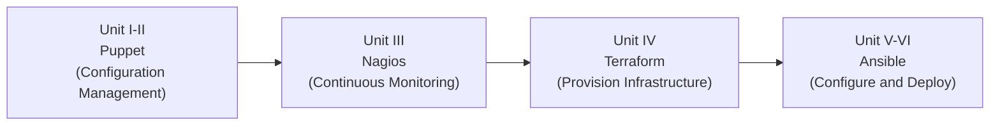

| Course Outcome | Covered In |
|---|---|
| CO1: Basics of Puppet | Unit I |
| CO2: Configuration management using Puppet | Unit II |
| CO3: Install and configure Nagios | Unit III |
| CO4: Infrastructure automation with Terraform | Unit IV |
| CO5: Fundamentals of Ansible and installation | Unit V |
| CO6: Build Ansible playbooks | Unit VI |

---

## Unit I: Puppet Basics

### 1. Configuration Management (CM)
CM is the practice of keeping servers in a **desired, consistent state** automatically, instead of configuring each one by hand.

**Benefits:** consistency, repeatability, less human error, version control of infrastructure, faster scaling.

### 2. Pull vs Push Model

| | Push | Pull |
|---|---|---|
| Who starts the update? | Central server pushes config to nodes | Nodes fetch config from the server |
| Agent needed on node? | Usually no | Yes |
| Example tools | Ansible | Puppet, Chef |

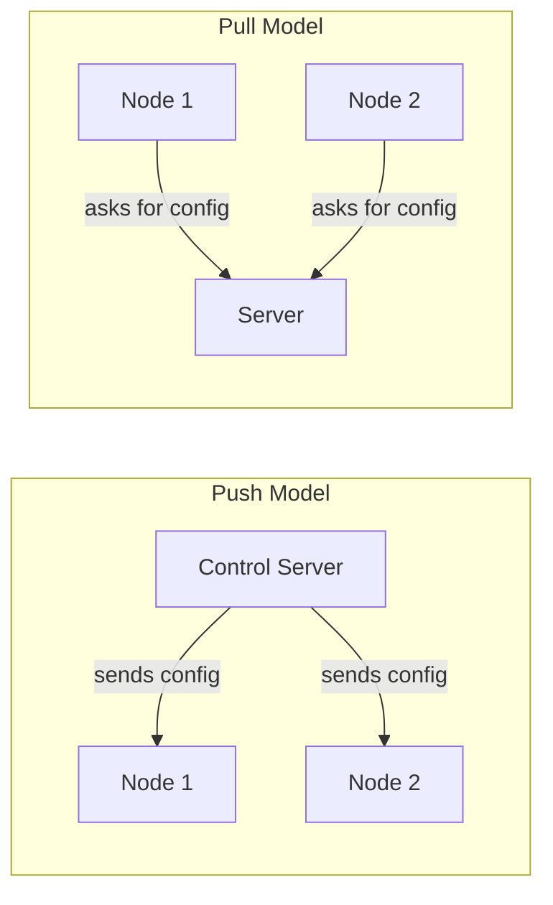

### 3. What is Puppet?
- Open-source configuration management tool, written in **Ruby**
- Uses its own **declarative language** (you describe *what* the end state should be, not *how* to reach it)
- Works on a **pull model** with a master-agent setup
- **Idempotent**: running it many times gives the same result

**Why Puppet?** Manages thousands of nodes, cross-platform (Linux/Windows), large community, reusable modules (Puppet Forge).

### 4. Puppet Architecture

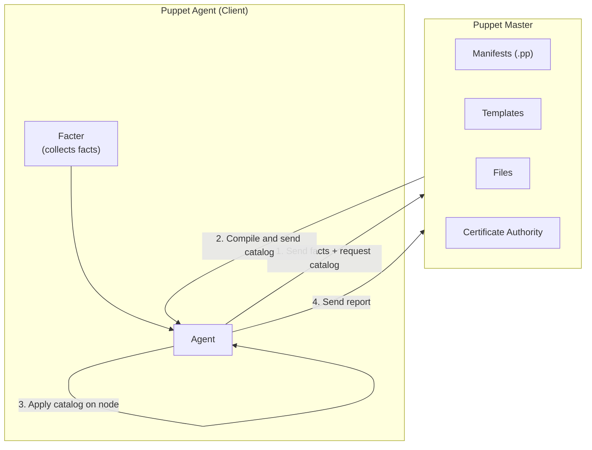

| Component | Purpose |
|---|---|
| **Manifest** | File (`.pp`) with Puppet code describing resources |
| **Template** | Files (ERB/EPP) with variables, used to generate dynamic config |
| **Files** | Static files served from master to agents |
| **Certificate Authority (CA)** | Issues and signs SSL certificates so master and agent trust each other |
| **Agent** | Runs on each node, fetches and applies the catalog |
| **Facter** | Gathers system info (OS, IP, memory) called *facts* |
| **Catalog** | Compiled list of resources and their desired state for one node |

### 5. Installation and Development in Isolation
- Install `puppet-agent` / `puppetserver` packages from the Puppet repository
- **Isolation** means testing safely without touching real servers, using **VirtualBox + Vagrant VMs** or `puppet apply` locally

```bash
puppet --version          # verify install
facter os                 # view a fact
```

---

## Unit II: Advanced Puppet

### 1. Puppet Configuration
Main config file: `puppet.conf` (sections: `[main]`, `[server]`, `[agent]`).

### 2. Managing Packages
```puppet
package { 'httpd':
  ensure => installed,
}
service { 'httpd':
  ensure => running,
  enable => true,
}
```

### 3. Puppet Modules
A **module** is a self-contained, reusable bundle of manifests, files and templates.

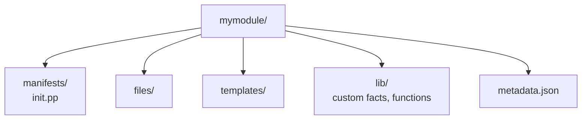

### 4. Connecting Agent with Master
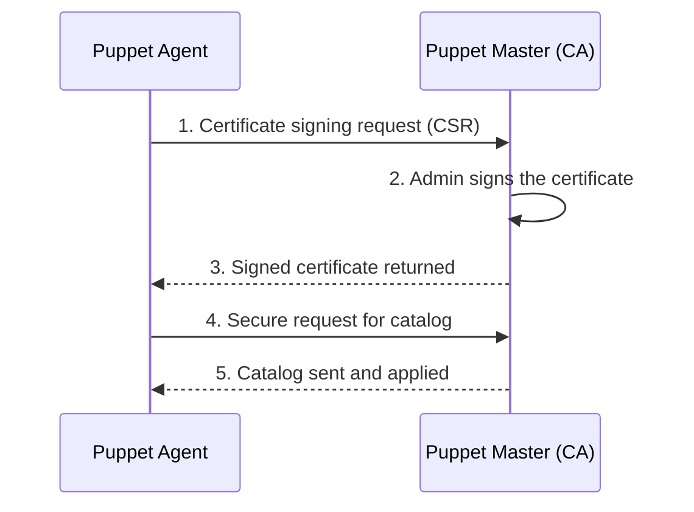
Commands: `puppet agent -t` (on agent), `puppetserver ca sign --certname <node>` (on master).

### 5. Making Configuration Dynamic
- **Facts** (from Facter): `$facts['os']['family']`
- **Variables** and **conditionals** (`if`, `case`, selectors)
- **Templates** (ERB/EPP) generate config files with variable values
- **Hiera**: separates data from code

### 6. Monitoring Web Servers, Load Balancing and Scaling
- Puppet can install and manage Apache/Nginx and keep it running
- Load balancers (e.g. HAProxy) can be configured by Puppet to spread traffic across web servers
- **Scaling Puppet:** add more **compile masters** behind a load balancer when the number of agents grows

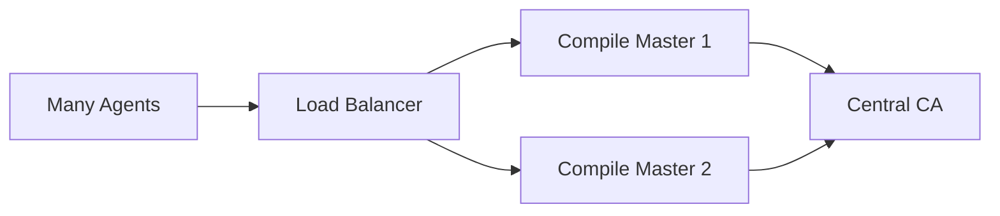

### 7. Extending Puppet, Classes and Functions
- **Class:** named block of Puppet code, reusable (`class apache { ... }`, then `include apache`)
- **Functions:** built-in (`include`, `notice`) or **custom** (written in Ruby or the Puppet language, placed in `lib/` or `functions/`)
- Extending Puppet: custom facts, custom types and providers, custom functions

### 8. Command Line and Manifests
| Command | Use |
|---|---|
| `puppet apply file.pp` | Apply a manifest locally (no master needed) |
| `puppet apply -e "package{'git': ensure=>present}"` | Run a one-line resource |
| `puppet resource package git` | Inspect or change a resource |
| `puppet parser validate file.pp` | Check syntax |

---

## Unit III: Nagios Monitoring

### 1. Continuous Monitoring (CM)
Constant, automated tracking of servers, apps and networks to detect problems early.
- **Importance:** reduces downtime, quick fault detection, capacity planning
- **Benefits:** alerts before users notice, performance history, supports DevOps feedback loops

### 2. Nagios Introduction
Open-source tool to monitor hosts, services and networks and send alerts.

**Features:** host and service monitoring, alerting (email/SMS), plugin-based, web interface, event handlers, reporting.

### 3. Nagios Architecture

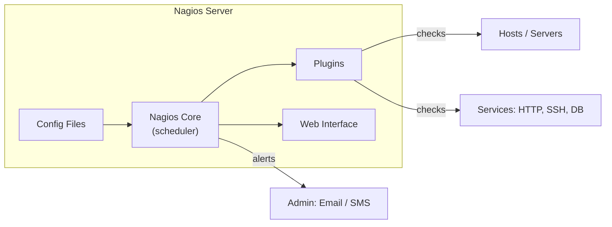

**Plugins** are small scripts or programs (Bash, Python, C, etc.) that perform a check and return a status code:

| Exit Code | State |
|---|---|
| 0 | OK |
| 1 | WARNING |
| 2 | CRITICAL |
| 3 | UNKNOWN |

### 4. Soft and Hard States
When a check fails, Nagios re-checks several times before raising a real alert, to avoid false alarms.

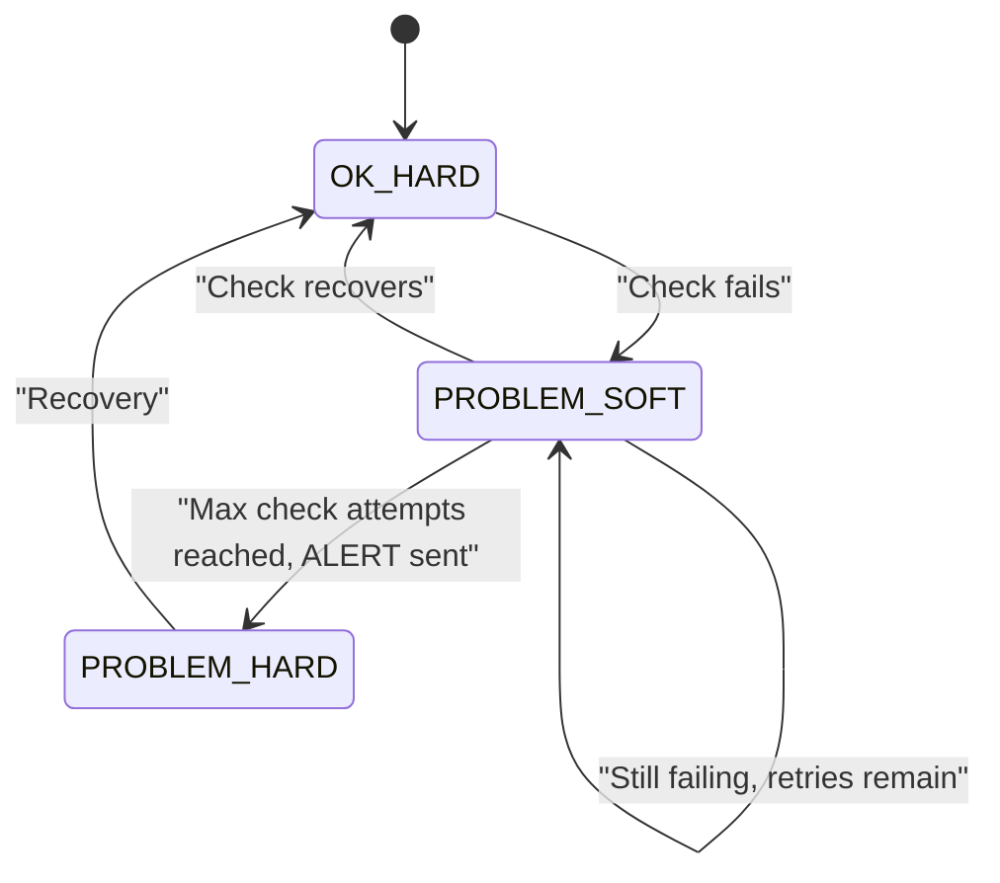

### 5. Installation
- **Package manager:** `apt-get install nagios4` (Ubuntu) or `yum install nagios` (CentOS)
- **From source:** install prerequisites (gcc, make, Apache, PHP), download, then `./configure`, `make all`, `make install`
- Set up a **web server (Apache)**, create a `nagiosadmin` user, then start the `nagios` service

### 6. Configuration and Web Interface
Key objects in config files: **host**, **service**, **contact**, **command**, **timeperiod**.

```cfg
define host {
    use         linux-server
    host_name   web01
    address     192.168.1.10
}
define service {
    use                   generic-service
    host_name             web01
    service_description   HTTP
    check_command         check_http
}
```
**Web interface lets you:** view/manage hosts and services, schedule **downtimes**, add **comments**, check system information and alerts.

---

## Unit IV: Infrastructure as Code with Terraform

### 1. What is Terraform?
Open-source **Infrastructure as Code (IaC)** tool by HashiCorp. You write infrastructure in **HCL** (HashiCorp Configuration Language), and Terraform creates it on AWS, Azure, GCP and more.

**Benefits:** repeatable, version-controlled, multi-cloud, automated, easy to destroy and recreate.
**Use cases:** provisioning servers, networks, databases, multi-cloud setups.

### 2. Architecture and Workflow

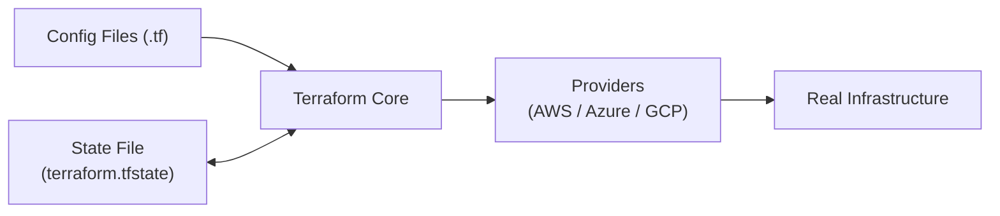


| Command | What it does |
|---|---|
| `terraform init` | Downloads providers, sets up the directory |
| `terraform plan` | Shows what will change (dry run) |
| `terraform apply` | Creates or updates infrastructure |
| `terraform destroy` | Deletes everything managed |

### 3. Sample Configuration
```hcl
provider "aws" {
  region = "ap-south-1"
}

resource "aws_instance" "web" {
  ami           = "ami-xxxxxxxx"   # replace with a valid AMI
  instance_type = "t2.micro"
  tags = { Name = "MyWebServer" }
}
```

### 4. Key Concepts
- **Resources and dependencies:** Terraform builds a dependency graph (implicit via references, explicit via `depends_on`)
- **State:** records what Terraform manages. Use **remote state** (e.g. S3 + locking) for teams
- **Modules:** reusable groups of resources
- **Workspaces:** multiple environments (dev/test/prod) from the same code
- **Terraform + Ansible:** Terraform **provisions** the servers, Ansible **configures** them

### 5. Best Practices and Security
- Never commit `terraform.tfstate` or secrets to Git
- Use remote state with locking and encryption
- Use variables, modules and version pinning
- Apply least-privilege IAM permissions
- Always review `terraform plan` before `apply`

---

## Unit V: Introduction to Ansible

### 1. What is Ansible?
- Open-source automation and configuration management tool (acquired by **Red Hat**)
- **Agentless:** uses **SSH** (or WinRM for Windows), nothing to install on nodes
- Uses **YAML** playbooks, **push** model, **idempotent**

### 2. How Ansible Works and Architecture

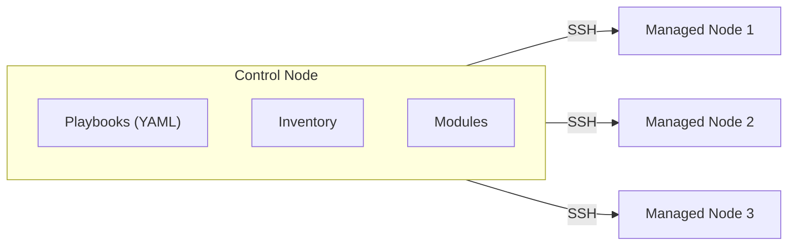

| Term | Meaning |
|---|---|
| Control node | Machine where Ansible is installed and run |
| Managed nodes | Servers being configured |
| Inventory | List of managed hosts (and groups) |
| Module | Unit of work (e.g. `apt`, `copy`, `service`) |
| Playbook | YAML file with the tasks to run |

### 3. From Shell Scripts to Ansible
| Shell Scripts | Ansible |
|---|---|
| Imperative (step by step) | Declarative (desired state) |
| Not idempotent | Idempotent |
| Hard to maintain at scale | Readable, reusable, scalable |

### 4. Installation and Inventory
```bash
sudo apt install ansible        # or: pip install ansible
ansible --version
```
**Basic inventory (`inventory.ini`):**
```ini
[webservers]
web1 ansible_host=192.168.1.10
web2 ansible_host=192.168.1.11

[dbservers]
db1 ansible_host=192.168.1.20
```
Ad-hoc command: `ansible webservers -i inventory.ini -m ping`

### 5. Using Ansible with Vagrant
Vagrant creates local VMs quickly. Ansible then configures them (Vagrant has a built-in `ansible` provisioner).
```bash
vagrant up        # create VM
vagrant provision # run the Ansible playbook on it
```

---

## Unit VI: Advanced Ansible

### 1. Playbook Structure
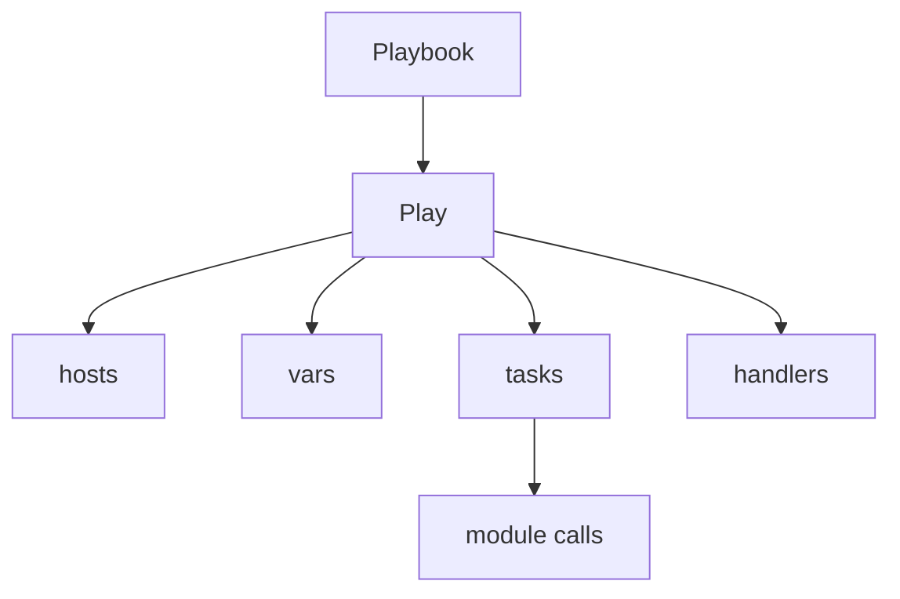

```yaml
---
- name: Install and start Apache
  hosts: webservers
  become: yes
  vars:
    pkg: apache2
  tasks:
    - name: Install Apache
      apt:
        name: "{{ pkg }}"
        state: present
      notify: Restart Apache
  handlers:
    - name: Restart Apache
      service:
        name: apache2
        state: restarted
```
Run with: `ansible-playbook -i inventory.ini site.yml`

### 2. Key Features
| Feature | Explanation |
|---|---|
| **Roles** | Standard folder structure to organise tasks, vars, handlers, templates and reuse them |
| **Handlers** | Tasks that run only when *notified* by a change (e.g. restart a service) |
| **Variables** | Store values (`vars`, `group_vars`, `host_vars`, `-e` on CLI) |
| **Environment variables** | Set per task or play with `environment:` |
| **Facts** | Auto-collected system info (`ansible_facts`, gathered by `setup` module) |
| **Prompts** | Ask the user for input at runtime (`vars_prompt`) |
| **Tags** | Run only selected tasks (`--tags install`) |
| **Blocks** | Group tasks, with `rescue` and `always` for error handling |

### 3. Roles Structure
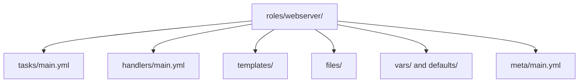
Create with: `ansible-galaxy init webserver`

### 4. Blocks and Tags Example
```yaml
tasks:
  - name: Web setup
    block:
      - name: Install nginx
        apt: { name: nginx, state: present }
        tags: install
    rescue:
      - debug: msg="Installation failed"
    always:
      - debug: msg="Finished"
```

### 5. Ansible with AWS (Application Deployment)


---

## Tool Comparison

| Feature | Puppet | Ansible | Terraform | Nagios |
|---|---|---|---|---|
| Purpose | Config management | Config management and automation | Infrastructure provisioning | Monitoring |
| Model | Pull | Push | Declarative (API calls) | Active checks |
| Agent | Yes | No (SSH) | No | Optional (NRPE) |
| Language | Puppet DSL | YAML | HCL | Config files |

## Practicals Overview

| No. | Experiment | Tool |
|---|---|---|
| 1 | Install VirtualBox, import Puppet and Ansible VMs | VirtualBox |
| 2 to 3 | Puppet install, basic manifests | Puppet |
| 4 to 6 | Modules, master-agent setup, facts and templates | Puppet |
| 7 to 10 | Install Nagios, custom plugins, web server monitoring, web UI | Nagios |
| 11 to 13 | Install Ansible, playbooks, deploy on AWS EC2 | Ansible |
| 14 to 15 | Install Terraform, Terraform with Ansible | Terraform and Ansible |

## References
1. *Mastering Puppet 5*, Ryan Russell-Yates, Packt Publishing
2. *Ansible for DevOps: Server and Configuration Management for Humans*, Jeff Geerling
3. *Learning Nagios*, Wojciech Kocjan
